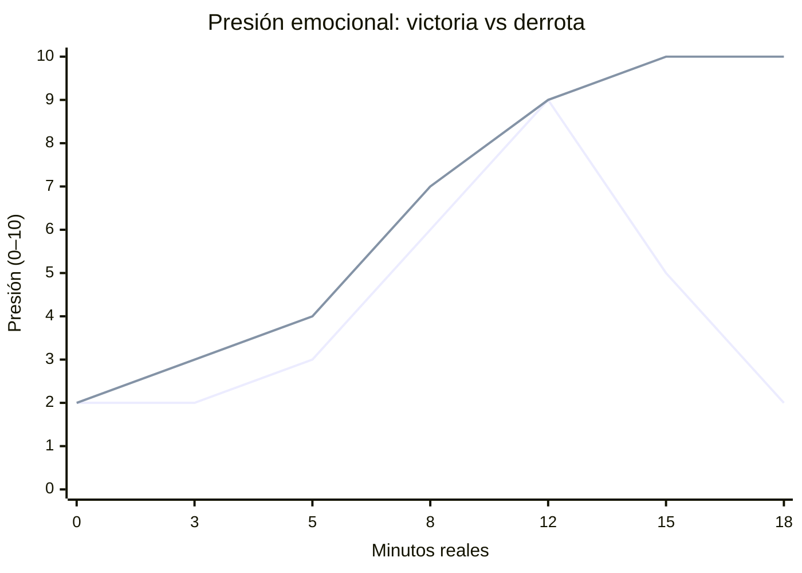

# EXP-0042 — Emotional pacing (propuesta, no telemetría)

**Dos relojes:** eje horizontal = **minutos reales estimados de una partida** (no minutos simulados del expediente). El ciclo de consulta/recorrido/decisión dura 2–3 minutos reales y se repite. El deadline ficcional continúa en el **minuto simulado 30**. Las curvas representan **presión percibida** (0 = calma; 10 = máxima); son objetivos de playtesting, no métricas observadas.

**Primera línea:** partida ganadora. **Segunda línea:** partida perdedora.

| Minuto real | Ganadora | Perdedora | Disparador dramático observable |
| --- | --- | --- | --- |
| 0–5 | 2→3 | 2→4 | Dominio de reglas: leer expediente, reconocer Courtyard/Registry; primer permiso corregible |
| 5–8 | 3→6 | 4→7 | Se vuelve evidente la diferencia entre simpatía, evidencia y autorización |
| 8–12 | 6→9 | 7→9 | Falta HISTORY o READY; planes de viaje compiten con tiempo; m20–24 puede complicar el trámite |
| 12–15 | 9→5 | 9→10 | Ganadora consigue permiso y cadena de procedencia; perdedora acumula coste por elecciones válidas improductivas |
| 15–18+ | 5→2 | 10→10 | Validar antes del m30 vs cierre por vencimiento y consecuencias explicadas |

La curva no fuerza estados: un jugador experto puede acabar antes, y otro descubrir el error más tarde. El Director Narrativo **solo selecciona o presenta hechos autorizados** por el estado canónico. No introduce incidentes ni consume tiempo para satisfacer la curva.

## Reglas de tuning

1. **Presión sin confusión:** cada denegación muestra responsable, motivo visible, minutos simulados restantes y una acción viable.
2. **Alivio merecido:** revelar una pista o conceder permiso únicamente después de satisfacer sus precondiciones.
3. **Fracaso inteligible:** el cierre debe explicar qué faltó y sus consecuencias; no borrar pruebas ni manipular conocimiento a posteriori.
4. **Una cámara no es un evento:** cambiar de vista jamás altera el reloj ni el case state.
5. **Test posterior:** medir tiempo real de 10 partidas por ruta; comparar curvas; documentar desviaciones antes de ajustar diálogos, agenda o costes.

Referencia: [arco del caso](EXP-0042_case_arc.md), [loop de jugador](moment_to_moment.md), [feedback](../../data/design/feedback_catalog.json).
